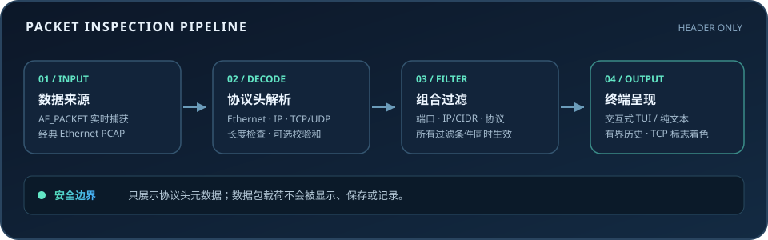

<div align="center">
  
  <h1>Micro-Dump</h1>
  <p><strong>面向 Linux 的轻量级终端抓包与协议头分析工具</strong></p>
  <p>使用 Python 3.11+ 标准库 · Linux AF_PACKET · 离线 PCAP · 仅检查协议头</p>
</div>

<p align="center">
  
  
  
  
</p>

Micro-Dump 是一个用于 Linux 的命令行网络数据包检查器。它可以从指定网卡实时读取数据包，也可以离线读取经典 Ethernet PCAP 文件，并将协议头信息呈现在交互式终端界面或纯文本输出中。

工具只展示由协议头解析得到的元数据，不打印、保存或记录数据包载荷；不调用 `tcpdump`、`tshark` 等外部抓包程序，也不会自动提权或启用混杂模式。

## 功能一览

- **实时捕获：** 使用 Linux `AF_PACKET` 原始套接字，必须显式指定网卡。
- **离线分析：** 支持经典 Ethernet PCAP 的大小端微秒和纳秒时间戳格式。
- **协议解析：** Ethernet、最多两层 VLAN、ARP、IPv4、IPv6、TCP、UDP、ICMP 和 ICMPv6。
- **终端界面：** 数据包列表、选中数据包详情、暂停、清屏、键盘导航和颜色标记。
- **组合过滤：** 按端口、IPv4/IPv6 地址或 CIDR 网段、协议筛选；各过滤条件之间采用 AND 逻辑。
- **可选校验：** 使用 `--check-sums` 验证可验证的协议校验和。
- **有界内存：** 数据包历史和捕获队列都有固定上限。

## 界面预览



## 安装

需要 Python 3.11 或更高版本。在项目目录中创建独立虚拟环境并安装：

```bash
python3 -m venv .venv
source .venv/bin/activate
python -m pip install --no-build-isolation .
micro-dump --help
```

项目使用内置的轻量 PEP 517 构建后端，无需安装第三方运行依赖。所有命令都在项目虚拟环境中执行，不需要全局安装。

## 快速开始

### 查看网卡并开始实时捕获

```bash
micro-dump --list-interfaces
micro-dump --interface eth0
```

请把 `eth0` 换成实际网卡名称。实时捕获需要 Linux `AF_PACKET` 套接字访问权限，具体配置见[权限要求](#实时捕获权限)。

### 读取本地 PCAP

```bash
micro-dump --read ./capture.pcap
micro-dump --read ./capture.pcap --plain --count 100
micro-dump --read ./capture.pcap --plain --no-color --check-sums
```

离线模式不需要 root 权限、不打开网卡，也不访问网络。当前只支持经典 Ethernet PCAP；PCAP-NG 和其他链路类型不在支持范围内。

## 过滤器

过滤器可以组合使用。每种过滤器内部的逗号列表表示任意一个值匹配即可；不同过滤器之间必须同时匹配。

| 参数 | 示例 | 说明 |
| --- | --- | --- |
| `--port` | `--port 80,443` | 源端口或目标端口匹配任一指定端口 |
| `--ip` | `--ip 192.168.1.10` | 源地址或目标地址匹配指定 IPv4/IPv6 地址 |
| `--ip` CIDR | `--ip 192.168.1.0/24 --ip 2001:db8::/32` | 源地址或目标地址属于任一指定网段；可重复提供参数 |
| `--proto` | `--proto tcp,udp` | 匹配 `tcp`、`udp`、`icmp`、`icmp6`、`arp` |

例如，只查看指定网卡上访问 HTTP/HTTPS 端口的 TCP 流量：

```bash
micro-dump --interface eth0 --port 80,443 --proto tcp
micro-dump --read capture.pcap --ip 192.168.1.0/24 --proto tcp,udp --plain
```

无效的端口、地址、CIDR 或协议值会在打开实时捕获套接字前被拒绝。

## 终端操作与输出

当标准输入和标准输出都连接到终端时，默认进入交互界面；重定向或管道场景默认输出纯文本。

| 按键 / 参数 | 行为 |
| --- | --- |
| `↑` / `↓` | 选择上一条或下一条数据包 |
| `Space` | 暂停 / 恢复接收与列表更新 |
| `c` | 清空当前显示历史 |
| `?` | 显示 / 隐藏快捷键帮助 |
| `q` | 退出并恢复终端状态 |
| `--plain` | 强制使用逐包文本输出 |
| `--no-color` | 禁用 ANSI 颜色；也遵循 `NO_COLOR` 环境变量 |
| `--count N` | 处理 N 个匹配的数据包后停止，N 必须大于零 |
| `--history N` | 设置界面保留的数据包数量，默认 500 |
| `--check-sums` | 检查适用的 IPv4、TCP、UDP、ICMP 和 ICMPv6 校验和 |

TCP 标志会突出显示：SYN 为绿色、RST 为红色、FIN 为黄色。校验和结果可能显示为通过、错误、未检查或不适用，具体取决于协议和报文内容。终端尺寸变化会触发重新绘制，窄窗口中的内容会被裁切以适应宽度。

## 实时捕获权限

Micro-Dump 使用 Linux `AF_PACKET` 原始套接字。当前用户必须在相应网络命名空间中具有 `CAP_NET_RAW` 能力，或已有等效权限。无权限时，程序会给出错误说明并退出；它不会自动运行 `sudo` 或修改权限。

管理员可按需向专用 Python 解释器授予能力，例如：

```bash
sudo setcap cap_net_raw+ep /path/to/venv/bin/python
getcap /path/to/venv/bin/python
```

授予能力前应评估安全影响：该解释器运行的程序都可能获得原始网络套接字权限。也可以在已经获准访问原始套接字的会话中运行。Micro-Dump 不启用混杂模式。按 `Ctrl-C` 或在界面中按 `q` 可停止捕获。

## 解析范围与限制

- 支持 Ethernet、最多两层 VLAN 标签、ARP、IPv4（含选项与分片）、IPv6（含扩展头与分片）、TCP、UDP、ICMP 和 ICMPv6。
- IPv6 扩展头遍历最多处理 12 个头，以限制异常报文造成的资源消耗。
- 按 IPv4 头长度及 IPv6 扩展头长度定位传输层；遇到缺少传输头的分片时显示分片信息，不猜测端口。
- 截断和不合法的报文头会显示解析错误，不应导致程序崩溃。
- 不支持 PCAP-NG、非 Ethernet 链路类型、载荷分析或数据包注入。
- 原始帧只在内存中短暂保留以完成解析和展示；界面、输出、日志均不输出或保存载荷字节。

> [!WARNING]
> 即使不显示载荷，IP 地址、端口、时间戳和协议元数据也可能属于敏感信息。请仅在有授权的网络和文件上使用，并妥善保护包含流量元数据的终端会话。

## 开发与验证

运行标准库测试并构建 wheel：

```bash
python -m unittest discover -v
python -m py_compile micro_dump/*.py micro_dump_build.py
python -m pip wheel --no-deps --no-build-isolation --wheel-dir dist .
```

测试使用合成 Ethernet 帧和临时 PCAP 文件，不要求 root 权限，不打开真实网卡，也不访问网络。
