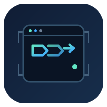
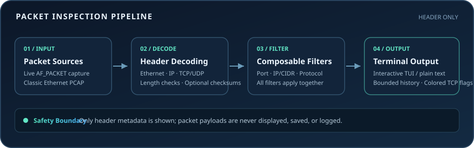

<div align="center">
  
  <h1>Micro-Dump</h1>
  <p><strong>A lightweight Linux packet inspection CLI with a polished terminal UI</strong></p>
  <p>Python 3.11+ · Linux AF_PACKET · Offline PCAP · Header-only inspection</p>
  <p><a href="README.zh-CN.md">简体中文文档（Chinese README）</a></p>
</div>

<p align="center">
  
  
  
  
</p>

Micro-Dump is a Linux command-line network packet inspector. Capture packets from an explicitly selected interface or replay classic Ethernet PCAP files, then inspect decoded headers in an interactive terminal UI or readable plain-text output.

Micro-Dump displays header-derived metadata only. Packet payload bytes are never printed, saved, or logged. It does not invoke external packet tools such as `tcpdump` or `tshark`, automatically elevate privileges, or enable promiscuous mode.

## Features

- **Live capture:** Linux `AF_PACKET` raw sockets with an explicitly selected interface.
- **Offline replay:** Classic Ethernet PCAP in little- or big-endian microsecond and nanosecond timestamp formats.
- **Protocol decoding:** Ethernet, up to two VLAN tags, ARP, IPv4, IPv6, TCP, UDP, ICMP, and ICMPv6.
- **Interactive terminal UI:** Packet list, selected-packet details, keyboard navigation, pause/resume, and color-coded TCP flags.
- **Composable filters:** Source or destination ports, IPv4/IPv6 addresses and CIDR ranges, and protocol filters.
- **Optional checksum checks:** Verify supported checksums with `--check-sums`.
- **Bounded memory:** Fixed-size packet history and a bounded capture queue.

## Overview



## Installation

Requires Python 3.11 or newer. From the project directory, create and activate a project-local virtual environment, then install Micro-Dump:

```bash
python3 -m venv .venv
source .venv/bin/activate
python -m pip install --no-build-isolation .
micro-dump --help
```

The project includes a small PEP 517 build backend and has no third-party runtime dependencies. Installation stays inside `.venv`; nothing is installed globally.

## Quick start

### List interfaces and capture live traffic

```bash
micro-dump --list-interfaces
micro-dump --interface eth0
```

Replace `eth0` with your interface name. Live capture requires permission to open Linux `AF_PACKET` raw sockets. See [Live capture permissions](#live-capture-permissions).

### Read a PCAP file

```bash
micro-dump --read ./capture.pcap
micro-dump --read ./capture.pcap --plain --count 100
micro-dump --read ./capture.pcap --plain --no-color --check-sums
```

Offline mode does not need root privileges, open interfaces, or network access. PCAP-NG and non-Ethernet link types are not supported.

## Filters

Filters compose with **AND** semantics. Comma-separated values within a single filter are alternatives.

| Option | Example | Behavior |
| --- | --- | --- |
| `--port` | `--port 80,443` | Match either the source or destination port against any listed port. |
| `--ip` | `--ip 192.168.1.10` | Match the source or destination IPv4/IPv6 address. |
| `--ip` with CIDR | `--ip 192.168.1.0/24 --ip 2001:db8::/32` | Match either endpoint against any listed network. Repeat the option as needed. |
| `--proto` | `--proto tcp,udp` | Match `tcp`, `udp`, `icmp`, `icmp6`, or `arp`. |

Examples:

```bash
# TCP traffic involving HTTP or HTTPS ports on a selected interface
micro-dump --interface eth0 --port 80,443 --proto tcp

# Filter a capture file by network and transport protocol
micro-dump --read capture.pcap --ip 192.168.1.0/24 --proto tcp,udp --plain
```

Invalid ports, addresses, CIDR ranges, and protocol values are rejected before a live capture socket is opened.

## Terminal controls and output

The interactive UI is enabled by default when stdin and stdout are terminals. When output is redirected or piped, Micro-Dump defaults to plain text.

| Key / option | Action |
| --- | --- |
| `↑` / `↓` | Select the previous or next packet. |
| `Space` | Pause or resume list updates. |
| `c` | Clear the displayed packet history. |
| `?` | Show or hide keyboard help. |
| `q` | Quit and restore the terminal. |
| `--plain` | Force one-line-per-packet output. |
| `--no-color` | Disable ANSI colors. The `NO_COLOR` environment variable is also respected. |
| `--count N` | Stop after processing N matching packets; N must be greater than zero. |
| `--history N` | Set the maximum packet history size (default: 500). |
| `--check-sums` | Verify applicable IPv4, TCP, UDP, ICMP, and ICMPv6 checksums. |

TCP flags are highlighted: SYN in green, RST in red, and FIN in yellow. Checksum status depends on the protocol and available packet data. The UI redraws on terminal resize and clips rows to fit narrow windows.

## Live capture permissions

Micro-Dump uses Linux `AF_PACKET` raw sockets. The process must have `CAP_NET_RAW` in the relevant network namespace or equivalent permission. If permission is unavailable, Micro-Dump explains the problem and exits. It never runs `sudo` or changes privileges automatically.

An administrator may grant this capability to a dedicated virtual-environment Python interpreter, if appropriate:

```bash
sudo setcap cap_net_raw+ep /path/to/venv/bin/python
getcap /path/to/venv/bin/python
```

Granting capabilities to an interpreter means programs run by that interpreter may gain raw-socket access; consider the security implications before doing so. You can also run Micro-Dump from a session that is already authorized to open raw sockets. Promiscuous mode is never enabled. Use `Ctrl-C` or press `q` to stop capture.

## Supported protocols and limits

- Ethernet, up to two VLAN tags, ARP, IPv4 (including options and fragments), IPv6 (including extension headers and fragments), TCP, UDP, ICMP, and ICMPv6.
- IPv6 extension-header traversal is limited to 12 headers to bound resource use on malformed packets.
- Transport headers are located using IPv4 header length and IPv6 extension-header lengths. Fragments without a transport header show fragment metadata instead of guessed ports.
- Truncated or malformed headers are reported as decode errors rather than crashing the program.
- PCAP-NG, non-Ethernet link types, payload analysis, and packet injection are out of scope.
- Raw frames are held transiently in memory for decoding and display. Payload bytes are not printed, saved, or logged.

> [!WARNING]
> Header metadata such as IP addresses, ports, timestamps, and protocols can still be sensitive. Use Micro-Dump only with authorized networks and files, and protect terminal sessions containing traffic metadata.

## Development and verification

Run the standard-library test suite and build a wheel locally:

```bash
python -m unittest discover -v
python -m py_compile micro_dump/*.py micro_dump_build.py
python -m pip wheel --no-deps --no-build-isolation --wheel-dir dist .
```

Tests use synthetic Ethernet frames and temporary PCAP files. They do not require root privileges, real interfaces, packet utilities, or external network access.
